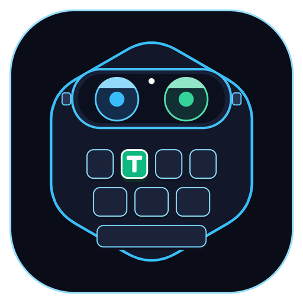

<div align="center">



# VRC-TransKey

**为 VRChat 打造的 Spatial Cyber-Glass 空间悬浮中文拼音键盘 & 实时多语翻译终端**

[](https://github.com/2952151730-svg/vrc-transkey/releases)
[](#)
[](#)
[](https://transkeyvr.top)

[官网主页](https://transkeyvr.top) · [下载最新版本](https://github.com/2952151730-svg/vrc-transkey/releases) · [English](#english)

</div>

---

## ✨ v1.3.0 核心更新

- **全新 Spatial Cyber-Glass 立体空间 UI**：重构整套渲染管线，采用深空玻璃拟态、3D 立体键帽层次、霓虹高光边框与动态状态指示，兼顾 VR 头显内的清晰度与视觉质感。
- **双栏模块化控制中心**：设置界面重新规划为三大清晰页签——`翻译引擎`、`语言与输入`、`空间与引导`，常用开关与 API/模型配置一目了然。
- **悬停与按压即时反馈**：新增射线悬停高亮发光、物理按压微移形变与顶部 Toast 状态提示，盲操与点选的手感更干脆。
- **精简高频词库与内存优化**：
  - 词库裁剪为 **8,757 个规范单字 + 近 10 万条核心高频词组**（共计 **103,886 词条**，源自雾凇词库精简），大幅减少冷门生僻字与长尾噪音对候选栏和内存的干扰。
  - 限制低频混拼索引开销，**冷启动约 0.6 秒**，桌面预览专用内存降至 **~130 MB**（工作集 **~160 MB**），与主流轻量工具相当。

---

## 🚀 主要特性

| 模块 | 能力说明 |
| :--- | :--- |
| **空间悬浮键盘** | 基于 OpenVR Overlay + PyQt6 + OpenGL 纹理直传，零闪烁高帧率跟随视角或固定在空间中，支持手柄/射线调节位置与缩放。 |
| **本地中文拼音引擎** | 支持全拼、简拼、混拼、智能组词与本地自造词记忆（`data/user_dict.json`），8 栏全宽候选框配合翻页与内置 Emoji 表情面板。 |
| **多引擎实时翻译** | 支持 **Google 免费翻译**、**MyMemory**、**DeepSeek AI**、**Google Gemini** 以及 **本地 Ollama**，支持 13 种目标语言一键切换与原文/双语对照发送。 |
| **OSC 直连聊天框** | 通过标准 VRChat OSC 协议（`127.0.0.1:9000`）直达游戏内 Chatbox，支持自动输入状态（Typing Indicator）与自动/手动发送模式。 |
| **VD / SteamVR 智能射线** | 针对 Virtual Desktop 与原生 SteamVR 环境做了控制器射线与悬停状态隔离，避免误触与穿模。 |
| **无头显桌面预览** | 提供 `--desktop` 预览模式，可在不启动 SteamVR 的情况下直接测试输入、翻译与 UI 效果。 |

---

## 📦 快速开始

### 方式一：直接运行发行版（推荐）
1. 前往 [Releases 页面](https://github.com/2952151730-svg/vrc-transkey/releases) 下载 `VRC-TransKey.exe`。
2. 在 VRChat 中开启 **OSC**（Action Menu → Options → OSC → Enabled）。
3. 启动 SteamVR 后双击运行 `VRC-TransKey.exe`；若只想在电脑桌面体验界面与输入法，可同时下载 `启动_桌面预览模式.bat` 放在同一目录双击启动。

> **关于自定义 AI 翻译**：在键盘右上角点击 `设置 (⚙)` → `翻译引擎` 即可切换引擎，或在软件同级 `config.json` 中填入 `deepseek_api_key` / `google_api_key`（本仓库默认留空，不包含任何私钥）。

### 方式二：从源码运行
```bash
git clone https://github.com/2952151730-svg/vrc-transkey.git
cd vrc-transkey
python -m venv .venv
.venv\Scripts\activate
pip install PyQt6 PyOpenGL openvr python-osc requests
```
- VR 模式启动：`python main.py`
- 桌面预览模式：`python main.py --desktop`（或运行 `启动_桌面预览模式.bat`）

---

## 📁 项目结构

```text
vrc-transkey/
├── main.py                # 主程序状态机、键盘交互、OSC 与翻译调度
├── ui_renderer.py         # Spatial Cyber-Glass 渲染器（键盘 / 设置中心 / Toast）
├── vr_overlay.py          # OpenVR Overlay 管理、OpenGL 纹理同步与射线检测
├── pinyin_engine.py       # 雾凇精简拼音引擎（全拼 / 简拼 / 混拼 / 用户词频学习）
├── translator.py          # 多引擎异步翻译（Google / MyMemory / DeepSeek / Gemini / Ollama）
├── osc_client.py          # VRChat OSC Chatbox 发送客户端
├── config.json            # 运行时配置（引擎、语言、Overlay 位姿与键位设置）
├── data/
│   ├── base_dict.tsv      # 103,886 条核心词库（8,757 规范单字 + 10万高频词组）
│   ├── emoji_pack.json    # 内置颜文字与 Emoji 面板数据
│   └── user_dict.json     # 本地用户习惯词频（运行时自动更新）
├── VRC-TransKey.spec      # PyInstaller 单文件打包配置
└── 启动_桌面预览模式.bat   # 无 VR 头显一键桌面预览脚本
```

---

<a id="english"></a>

## 🌐 English Overview

**VRC-TransKey** is a lightweight Spatial Cyber-Glass floating Chinese Pinyin keyboard and real-time multi-language translator built for **VRChat** on Windows (SteamVR / Virtual Desktop).

### Highlights in v1.3.0
- **Spatial Cyber-Glass UI**: Redesigned 3D glassmorphic keycaps, neon edge highlights, hover glow, physical press feedback, and top toast notifications.
- **3-Tab Modular Control Center**: Organized settings for **Translation Engine**, **Language & Input**, and **Space & Guide**.
- **Trimmed High-Frequency Lexicon & Memory Optimization**:
  - Curated to **8,757 standard single characters + ~100k core high-frequency phrases** (**103,886 entries total**), cutting memory noise and improving candidate accuracy.
  - Fast **~0.6s** cold start and reduced memory footprint (**~130 MB private / ~160 MB working set** in desktop preview).
- **Multi-Engine Translation & Direct OSC**: Supports Google Free, MyMemory, DeepSeek, Google Gemini, and local Ollama across 13 target languages, sending directly to VRChat Chatbox via `127.0.0.1:9000`.

---

## 📄 License

Licensed under the [MIT License](LICENSE).
